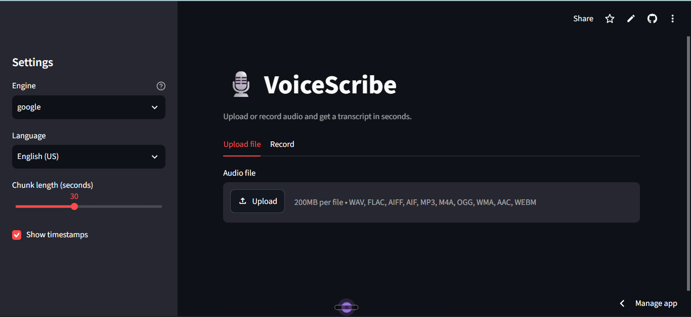

# VoiceScribe: Speech-to-Text Transcription Tool

A simple, well-tested tool that converts audio recordings into text. Use it from
the **command line** or a **web app**, with timestamps and subtitle export.

Built with Python and the [SpeechRecognition](https://pypi.org/project/SpeechRecognition/) library.

## Features
- Transcribes WAV, FLAC, AIFF directly; MP3, M4A, OGG and more via ffmpeg
- Handles long recordings by splitting audio into chunks, with progress reporting
- Timestamped segments, exported as **TXT**, **SRT** (subtitles) or **JSON**
- Multiple languages (English, Hindi, Kannada, Tamil, Telugu, Spanish and more)
- Swappable engines: Google Web Speech API (default), Whisper and Sphinx (offline)
- Streamlit web UI: upload a file or record from your microphone
- Accuracy evaluation with Word Error Rate (`evaluate.py`)
- Unit tests with mocked recognition (no internet needed)

  ## **🔗 Project Live:** 

Link 🔗: (https://voicescribe-x7bafqvdngwwtwrvvksdwj.streamlit.app/)


## 🎥 Demo video

[](https://drive.google.com/file/d/1RfjfAeTl7TACpqMJHVcZHytrFqq-6q63/view?usp=sharing)

*Click the **Watch Demo Button** to watch demo (Google Drive).*

## Dashboard


## Project structure
```
voicescribe/
├── app.py              # Streamlit web app
├── transcribe.py       # Command-line interface
├── evaluate.py         # Word Error Rate checker
├── scribe/
│   ├── engine.py       # chunking + recognition logic
│   ├── audio_utils.py  # format conversion (pydub/ffmpeg)
│   └── export.py       # txt / srt / json output
├── tests/test_core.py
├── sample_audio/       # put your test clips here
└── requirements.txt
```

## Setup
```bash
python -m venv .venv
source .venv/bin/activate        # Windows: .venv\Scripts\activate
pip install -r requirements.txt
```
For MP3/M4A/OGG files install **ffmpeg** (`sudo apt install ffmpeg`, `brew install ffmpeg`,
or download from ffmpeg.org on Windows).

## Usage
**Web app**
```bash
streamlit run app.py
```

**Command line**
```bash
python transcribe.py sample_audio/talk.wav
python transcribe.py talk.mp3 -f srt -o talk.srt
python transcribe.py talk.wav --timestamps -l en-IN
python transcribe.py talk.wav --engine whisper     # offline
python transcribe.py --mic                         # needs pyaudio
```

**Python API**
```python
from scribe import transcribe_file, to_txt
segments = transcribe_file("talk.wav", language="en-IN")
print(to_txt(segments, timestamps=True))
```

## Testing and evaluation
```bash
pytest
python evaluate.py sample_audio/clip.wav sample_audio/clip.txt   # needs: pip install jiwer
```

## How it works
1. `audio_utils.ensure_wav` converts unsupported formats to WAV.
2. `engine.transcribe_file` reads the audio in fixed-length chunks, so long files fit
   within the free API's limits, and records each chunk's start and end time.
3. Each chunk goes to the selected recognition engine; unintelligible chunks are skipped.
4. `export` formats the timestamped segments as TXT, SRT or JSON.

## Limitations
- The Google engine needs internet and is less accurate with heavy noise, strong accents or overlapping speakers.
- Chunks are cut at fixed intervals, so a word may occasionally be split at a boundary.
- No speaker identification (diarization).

## Future improvements
- Split on silence instead of fixed intervals
- Speaker diarization
- Batch-transcribe whole folders
- Docker image and cloud deployment

## License
MIT. See `LICENSE`.
